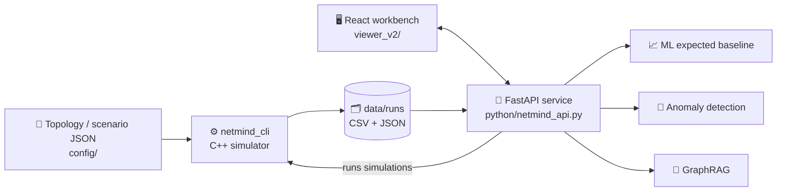

<div align="center">

# 🌐 NetMind

**A C++17 discrete-event network simulator with a command-line interface, a React workbench, and Python analysis tools.**


[Features](#-implemented-features) •
[Docker](#-run-everything-with-docker) •
[Build](#-build-and-test-the-c-project) •
[CLI](#-use-the-cli) •
[Workbench](#-use-the-api-and-react-workbench) •
[Anomalies](#-anomaly-detection) •
[Dataset](#-generate-the-ml-dataset) •
[Layout](#-repository-layout)

</div>

---

NetMind models a network from a topology or scenario file, simulates packet traffic and network events, and exports run data for comparison and review.

> [!NOTE]
> This README describes features present in the repository. It does not describe planned work.

## 🧭 How the pieces fit together



---

## ✨ Implemented features

### ⚙️ C++ network simulator

| | |
|---|---|
| 🧱 **Model** | Hosts, routers, switches, packets, flows, links, forwarding tables and simulation events |
| 📥 **Input** | Loads network topologies and scenarios from JSON files |
| 🕸️ **Graph** | Represents the topology as a graph, with breadth-first search, depth-first search, connected-component and reachability operations |
| 🧭 **Routing** | BFS, DFS, Dijkstra and Bellman–Ford. The CLI supports hop-count and latency weights |
| 📦 **Packets** | Transmission time, propagation delay, per-direction link queues, queue limits, packet loss, and link or router availability |
| 🚦 **Traffic** | Constant, Poisson and bursty flows |
| ⚡ **Events** | Scheduled link and router failures and restorations, temporary link congestion, and temporary burst traffic |
| 📊 **Output** | Collects packet traces, flow and network metrics, and event information. Exports run manifests and CSV files for traces, flows, links, time windows and network summaries |

### 💻 Command-line interface

The interactive CLI can load topologies or scenarios, configure routing and traffic, inspect routes and queues, run simulations, and export results.

| Group | Commands |
|---|---|
| 📂 Load and inspect | `load` · `show topology` · `show route` · `show queue` · `show metrics` |
| 🔧 Configure | `set algo` · `set weight` · `set seed` · `route add` · `add flow` |
| 🩺 Diagnose | `ping` · `traceroute` |
| ⚡ Events | `fail link` · `restore link` · `fail router` · `restore router` · `congest link` · `burst` |
| ▶️ Run | `run` · `step` · `compare` · `reset` |
| 💾 Output | `export` |
| 🚪 Session | `help` · `exit` |

The CLI can also run a text command script or a scenario file without interaction.

### 🖥️ Python API and React workbench

- A **FastAPI service** connects the workbench to the C++ simulator and to exported run files.
- The **React workbench** (`viewer_v2/`) has six pages:

  | Page | What you can do |
  |---|---|
  | 🗺️ **Topology** | Build a topology, or import a topology or a scenario file (topology + settings) |
  | 🎛️ **Simulation** | Configure and run simulations, either interactively or as a CLI script; save, download and import scenario files |
  | 📊 **Results** | Compare runs and see the expected-baseline results |
  | 📈 **Anomalies** | Enabled after a simulation runs. Shows which seconds of the current run the detector flagged and why, in four per-metric plots; the **i** button shows how the detector was evaluated |
  | ⏯️ **Replay** | Load a run into the replay viewer |
  | 💬 **Insights** | Ask GraphRAG questions about the runs |

- The **replay viewer** reads exported run files and shows packet movement, link load, drops and run comparisons. It doesn't run simulations itself.
- `docs/demo/` holds a demo topology and scenarios to import into the workbench.
- **Topology → Import scenario** also lists every scenario in `config/scenarios/`, with the S1–S4 demo scenarios first, so they open with one click.
- Every run made in the workbench is scored by the anomaly detector. Results shows the number of flagged seconds per run; Replay shades the injected event window and marks flagged seconds under the metric chart.

### 📈 ML expected baseline

The baseline estimates a run's latency, throughput and packet loss from its inputs: the topology plus the scenario's flows, events and routing settings. It works in two parts:

- **Physical estimate** (`ml/scenario_model.py`): recomputes each flow's path the way the simulator's routing does. It splits the run at every event, and in each interval it pushes every flow's rate through link capacities and loss rates. This estimate is the expected value.
- **Calibration** (`ml/baseline.py`): the generated runs measure how far real results stray from the estimate. A result is flagged when it differs by more than three times that typical error, and by more than a minimum size.

A Random Forest trained on the remaining error (`learn_correction=True`) made estimates worse on held-out topologies, so it is off by default. The API calibrates once per dataset version and never retrains on runs made in the workbench.

### 🔎 Anomaly detection

The detector works on the per-second `windows.csv` rows of many generated runs (see [Generate the window dataset](#-generate-the-window-dataset)):

| Module | What it does |
|---|---|
| `ml/features.py` | Cleans each run's windows (latency carried forward through seconds with no deliveries) and adds causal change features: 1- and 3-second deltas, the change against the previous 3-second mean, and the change against the run's own running median. Changes are divided by the run's reference level so runs with different loads compare. `active_failures` is excluded because it encodes the injected event |
| `ml/anomaly.py` | The detector is a z-score rule: a second is flagged when any single feature moves far outside its range in normal runs. IsolationForest is trained alongside it as the ML comparison. Both are fitted on seconds from event-free training runs only; runs are split 60/20/20 by run ID; each threshold is chosen on validation runs; the fixed \|z\| > 3 rule is also reported |
| `ml/plots.py` | Writes PNGs to `data/plots/`: anomaly timelines for both detectors, the detector comparison, and algorithm comparison bars |

Both fitted detectors and their thresholds are saved together in `data/models/anomaly_detectors.joblib`. The API attaches each run's result as `anomaly` (or an `error` when the detector has not been trained), re-scores a saved run with `POST /api/ml/anomaly`, and serves the evaluation and its plots from `GET /api/ml/anomaly/evaluation` and `GET /api/ml/plots/<name>`. `notebooks/ml_demo.ipynb` runs the whole story and finishes by applying the saved detectors to the S2 link-failure scenario.

| Detector (held-out runs) | Precision | Recall | F1 | False alarms on clean runs |
|---|---|---|---|---|
| ✅ z-score (used) | 0.60 | 0.58 | 0.59 | 3 % |
| IsolationForest | 0.39 | 0.71 | 0.51 | 20 % |
| z-score, fixed \|z\| > 3 | 0.43 | 0.74 | 0.54 | 16 % |

### 💬 GraphRAG

GraphRAG builds a NetworkX graph from topology, run, flow, event, trace and window data, and answers run-specific questions with supporting evidence. It has two modes:

| Mode | When | How it answers |
|---|---|---|
| 📐 **Rule-based** | Always available (default) | Matches supported question patterns and answers from recorded facts |
| 🤖 **LLM agent** | Only when `NETMIND_LLM_*` settings are provided | A LangGraph agent calls deterministic tools (`graphrag/tools.py`). Every number in its answer must appear in a tool result; otherwise it retries once, then falls back to the rule-based answer |

To enable the agent, copy `python/.env.example` to `python/.env` and fill in an OpenAI-compatible endpoint, API key and model. The model must support tool calling. `python/.env` is ignored by git, so never commit your key.

`graphrag/eval_questions.json` defines 20 questions over 4 seeded scenarios. `python -m graphrag.evaluation`, run from `python/`, scores both modes against answers computed directly from the run files.

---

## 🚧 Current scope limits

- On the generated window dataset the z-score detector beats IsolationForest, so the plan's "ML beats z-score" goal is not met. The z-score is the detector in use, and IsolationForest is kept as the reported comparison.
- Anomaly labels cover the whole injected interval, so a failure that is rerouted instantly, or that hits a link no flow uses, counts as anomalous even when nothing visible changes. This caps achievable recall.
- Forecasting future metrics is not implemented.
- ML predictions do not choose routes or change the simulator's routing decisions.
- GraphRAG's LLM agent is optional and limited to facts returned by its tools. It does not retrieve information from external knowledge sources.
- Run data is stored as local JSON and CSV files; there is no database service.

---

## 📁 Repository layout

```text
NetMind/
├── 📂 apps/                  C++ CLI entry point
├── 📂 include/netmind/       C++ public headers
│   ├── cli/                  Command framework and commands
│   ├── common/               Types, units, errors, IP, union-find, min-heap, RNG
│   ├── graph/                Graph and topology loader
│   ├── metrics/              Trace logger, metrics collector, exporters, report
│   ├── model/                Hosts, routers, switches, links, packets, flows
│   ├── routing/              Routing algorithms, weight policy, manager, factory
│   └── simulation/           Engine, event queue, channels, scenarios, events
├── 📂 src/                   C++ simulator implementation
├── 📂 tests/                 C++ tests and golden fixtures
├── 📂 python/                FastAPI service, ML baseline, GraphRAG and data tools
│   └── tests/                Python tests
├── 📂 viewer_v2/             React + TypeScript workbench (Vite)
├── 📂 config/
│   ├── topologies/           Example topology JSON files
│   └── scenarios/            Demo scenarios S1–S4 and other examples
├── 📂 notebooks/             ML demo notebook
├── 📂 docs/
│   ├── contracts/            Topology, scenario and trace file formats
│   ├── demo/                 Files to import into the workbench
│   └── conventions.md        Coding conventions
├── 🐳 Dockerfile · compose.yaml
├── 🛠️ CMakeLists.txt · CMakePresets.json
└── 📄 commands.txt           CLI command reference
```

---

## 🐳 Run everything with Docker

> [!WARNING]
> **Generate the baseline dataset first.** The image includes `data/dataset/`, which `.gitignore` keeps out of the repository. On a fresh clone, `docker compose up --build` fails until you've run [Generate the ML dataset](#-generate-the-ml-dataset). The image also includes the trained anomaly detector in `data/models/` and its plots in `data/plots/`, which are committed.

With Docker running, start the project from the repository root:

```sh
docker compose up -d --build
```

Then open **<http://localhost:8765>**.

One container builds and runs everything:

- ⚙️ the C++ simulator (built for Linux)
- 🐍 the API
- 🖥️ the workbench (`viewer_v2`)

| | |
|---|---|
| 🔒 **Port** | Bound to this computer only |
| 💾 **Data** | Runs and saved topologies and scenarios are kept in the `netmind-data` and `netmind-config` volumes, so they survive restarts and rebuilds. The baseline dataset is copied into `netmind-data` the first time the volume is created |
| 📈 **Anomaly detector** | The trained detector and its plots live in the image at `/app/ml`, outside the data volume, so a rebuild always brings the current model, even for an existing volume. Files of the same name in `netmind-data` take priority |
| 🎬 **Demo scenarios** | On every start the container copies any missing files from the image's `config/` into the `netmind-config` volume, so new scenarios such as S1–S4 appear without deleting the volume. Your saved files are never overwritten |
| 🤖 **GraphRAG LLM** | Settings in `python/.env` are passed in when the container starts and are never copied into the image |
| 🛑 **Stop** | `docker compose down` keeps your data. `docker compose down -v` also deletes the volumes |

---

## 🔨 Build and test the C++ project

From the repository root, configure, build and run the C++ tests:

```sh
cmake --preset debug
cmake --build --preset debug
ctest --preset debug
```

| Preset | Build folder | Use |
|---|---|---|
| `debug` | `build/debug` | Development and tests |
| `release` | `build/release` | Optimised build, e.g. for dataset generation |
| `sanitize` | `build/sanitize` | AddressSanitizer + UndefinedBehaviorSanitizer |

CMake downloads Catch2 and nlohmann/json when configuring, so the first configure needs network access. The presets use the Ninja generator. The CLI executable is created as `build/debug/netmind_cli` on Linux/macOS and `build/debug/netmind_cli.exe` on Windows.

<details>
<summary>Without presets</summary>

```sh
cmake -S . -B build/debug -DCMAKE_BUILD_TYPE=Debug
cmake --build build/debug --parallel
ctest --test-dir build/debug --output-on-failure
```

</details>

### 🐍 Python tests

From the repository root:

```sh
python -m pip install -r python/requirements.txt
cd python
python -m pytest -q
```

---

## 💻 Use the CLI

Start the interactive CLI from the repository root:

```sh
./build/debug/netmind_cli
```

On Windows PowerShell:

```powershell
.\build\debug\netmind_cli.exe
```

Example interactive session:

```text
load config/topologies/ring_backup.json
set seed 42
set algo dijkstra
set weight latency
add flow PC1 PC2 5 1000 0 10
run 10
show metrics
export
```

To run a saved scenario and export its output:

```sh
./build/debug/netmind_cli --scenario config/scenarios/ring_backup.json --out data
```

| Option | Effect |
|---|---|
| `--scenario FILE` | Run a scenario file |
| `--script FILE` | Run a text file of CLI commands |
| `--out DIR` | Output directory (default: `data/`) |
| `--json-summary` | Print a JSON summary of the run |
| `--quiet` | Reduce console output |
| `--help` | Show the supported options |

#### 🎬 Demo scenarios

All of these run for 60 s with seed 42:

| Scenario | Topology | What happens | What to look for |
|---|---|---|---|
| `s1_normal.json` | `medium10` | Three constant flows (5, 3 and 2 Mbps), Dijkstra, no events | Steady latency, 0 % loss |
| `s2_link_failure_dijkstra.json` | `ring_backup` | 5 Mbps flow; R1–R2 fails at 20 s and is restored at 40 s; 0.2 s reconvergence | Short drop window, latency rises on the backup path via R4, then returns |
| `s2_link_failure_bellman_ford.json` | `ring_backup` | Same failure with Bellman-Ford and 3 s reconvergence | About 3 s of drops instead of 0.2 s |
| `s3_congestion.json` | `dumbbell` | Two 30 Mbps flows over the 50 Mbps bottleneck, plus a 20 Mbps burst at 30–35 s | Bottleneck at ~100 % utilisation, full queue, tail drops |
| `s4_router_failure_congestion.json` | `ring_backup` | R2 fails at 15 s and is restored at 30 s; R1–R2 congested to 4 % bandwidth at 40–50 s | Reroute around a router, then queueing and drops on a degraded link |

```sh
./build/release/netmind_cli --scenario config/scenarios/s2_link_failure_bellman_ford.json --out data/demo --json-summary
```

In S3 the two flows have the same rate and start together, so their packets reach the bottleneck queue in a fixed order and one flow takes nearly all the tail drops. That is how a tail-drop queue behaves with synchronised constant-rate senders, not a fairness bug.

Type `help` inside the interactive CLI for the command list. Exported files are written to `data/` by default; use `--out` or the `export` command to choose another output directory. Each run produces `run_<id>_trace.csv`, plus flow, link, window and network CSV files and a JSON manifest.

---

## 🧩 Use the API and React workbench

**1. Install the Python dependencies** from the repository root:

```sh
python -m pip install -r python/requirements.txt
```

**2. Start the API** in one terminal:

```sh
python -m uvicorn netmind_api:app --app-dir python --host 127.0.0.1 --port 8765
```

> [!NOTE]
> The API defaults to `build/debug/netmind_cli.exe`. Set `NETMIND_CLI` to the actual executable path if you're on a platform that uses a different binary name, or if you built it elsewhere.

**3. Start the React workbench** in another terminal:

```sh
cd viewer_v2
npm install
npm run dev
```

Vite proxies `/api` requests to the local API on port `8765`.

| Script | What it does |
|---|---|
| `npm run dev` | Start the development server |
| `npm run build` | Typecheck and build for production |
| `npm run typecheck` | Run the TypeScript compiler only |
| `npm run lint` | Run ESLint |
| `npm test` | Run the Vitest unit tests |

---

## 📊 Generate the ML dataset

The baseline, its evaluation and the Docker image all need a generated dataset. Build the `release` preset first, then run from the repository root:

```sh
python python/ml/generate_dataset.py \
  --cli build/release/netmind_cli.exe \
  --topologies config/topologies/small4.json config/topologies/diamond_weighted.json \
               config/topologies/dumbbell.json config/topologies/ring_backup.json \
               config/topologies/medium10.json \
  --output data/dataset \
  --max-runs 600 \
  --workers 8 \
  --discard-runs
```

<details>
<summary>Windows PowerShell version</summary>

```powershell
python python\ml\generate_dataset.py `
  --cli build\release\netmind_cli.exe `
  --topologies config\topologies\small4.json config\topologies\diamond_weighted.json `
               config\topologies\dumbbell.json config\topologies\ring_backup.json config\topologies\medium10.json `
  --output data\dataset `
  --max-runs 600 `
  --workers 8 `
  --discard-runs
```

</details>

Each run gets a random reproducible scenario:

- 🔀 1 to 4 flows between random host pairs
- 🚦 constant, Poisson or bursty traffic
- ⚖️ hop or latency weights, and some reconvergence delay
- 💥 one disturbance: a link failure, router failure, congestion or burst, which often hits a link or router the traffic actually uses

The generator writes `runs_all.csv`, which includes each run's `scenario_json`, and the scenario files. `--discard-runs` skips the per-run trace files, which are large. Run `python python/ml/generate_dataset.py --help` to see all options.

### 📉 Generate the window dataset

Retraining the anomaly detector needs longer runs with labelled seconds. This writes `windows_all.csv` (one row per simulated second, with `is_anomaly`) and `runs_all.csv` to `data/windows_dataset/` in about 40 minutes on 8 workers, then retrains the detector and redraws the plots:

```sh
cd python
python -m ml.generate_dataset --cli ../build/release/netmind_cli.exe \
  --topologies ../config/topologies/medium10.json ../config/topologies/ring_backup.json \
               ../config/topologies/dumbbell.json ../config/topologies/diamond_weighted.json \
  --output ../data/windows_dataset --max-runs 400 --duration 30 --packet-bytes 1500 \
  --workers 8 --discard-runs
python -m ml.anomaly
```

A second is labelled anomalous when it overlaps an injected disturbance: from a failure to its matching restore (or the end of the run), or for the duration of a congestion or burst event. If you change `ml/features.py`, retrain and commit the new `data/models/` and `data/plots/` files together with it.

---

## 🧪 Data and tests

Generated simulation runs and datasets are local artifacts and are not included in the repository. The exceptions are the trained anomaly detector in `data/models/` and its plots in `data/plots/`, which are committed so the workbench and Docker image work without retraining. Topology and scenario examples are kept under `config/`.

| Suite | Framework | Command |
|---|---|---|
| ⚙️ C++ | Catch2 + CTest | `ctest --preset debug` |
| 🐍 Python | pytest | `cd python && python -m pytest -q` |
| 🖥️ Workbench | Vitest · TypeScript · ESLint | `npm test` · `npm run typecheck` · `npm run lint` (in `viewer_v2/`) |

`tests/golden/` holds the fixtures the C++ tests compare against: a mini topology, its golden trace, and invalid topology files for error handling.
